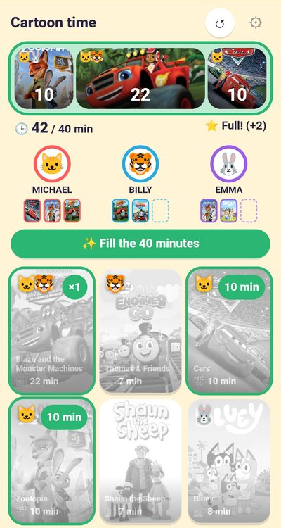
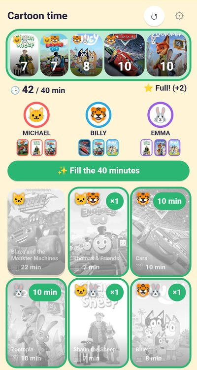
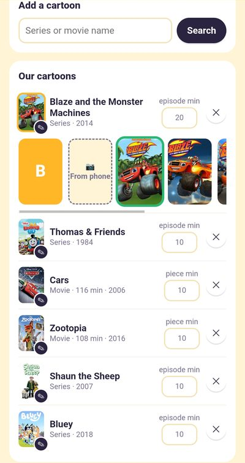

# 📺 Cartoon Time

### 👉 [**Try Cartoon Time live**](https://tomaskriks.github.io/ScreenTimeScheduler/) — free, no sign-up

Screen time without the arguing. Each kid picks their favourite cartoons, one tap fits them
into today's allowed minutes, and everybody can see that it's fair.

<p align="center">
  
  
  
</p>

## Put it on your phone in 30 seconds

1. Open **[tomaskriks.github.io/ScreenTimeScheduler](https://tomaskriks.github.io/ScreenTimeScheduler/)** in Chrome (Android) or Safari (iPhone).
2. Tap the menu (⋮ in Chrome, the share button in Safari) → **Add to Home screen**.
3. Open it from your home screen. It works like an app, even without internet.

## How it works

- **The bar at the top is today's cartoon time** (40 minutes to start with). Each chosen cartoon is a block in it,
  so kids can *see* what fits.
- **Wishes first:** each kid taps their face, then up to 3 favourite cartoons.
- **Then one tap: ✨ Fill the 40 minutes.** Every kid gets something if at all possible. Series get whole
  episodes, and movies share what's left in pieces (10 minutes or more), so a long movie is watched over a few days.
- **Or plan by hand:** tap a picture to add an episode or a movie piece, and tap a block to take it out.
- **Parents' corner:** hold the ⚙ gear (little fingers won't find it by accident). There you can:
  - search and add any series or movie,
  - fix episode lengths,
  - set the time,
  - set **2 to 5 kids** with their names and animal faces,
  - choose each cartoon's picture: another poster, a photo from your phone, or just the first letter.

**Private by design:** there's no account and no tracking. Everything is saved only on your phone.
The internet is used only to look up cartoons and their posters (on TVmaze and Wikipedia).

---

## For developers

Plain HTML, CSS and JavaScript in `docs/`, with no build step and no dependencies. It is an installable web app (PWA):
after the first visit it opens without internet, and everything is saved on the phone (`localStorage`).

| File | What it does |
|---|---|
| `docs/js/planner.js` | The rules: what fits, and how wishes are arranged |
| `docs/js/catalog.js` | Looks up series on TVmaze and movies on Wikipedia/Wikidata (free, no key), and the pictures to choose from |
| `docs/js/store.js` | Saving and loading |
| `docs/js/app.js` | The screens |
| `docs/sw.js` | Offline support |

TVmaze reports the TV slot length including adverts (30 min for a 22-minute episode). The app estimates
the real length for round slots; parents can correct it if it's off.

### Run it locally

```
dotnet run --project dev-server
```

Then open http://localhost:5080. Without .NET, any static server works, e.g. `cd docs && python -m http.server 5080`.

### Publish your own copy

Fork the repo, then **Settings → Pages → Deploy from a branch → `main` → `/docs`**.
After changing app files, raise the cache names at the top of `docs/sw.js` only if a file was renamed or removed;
normal edits reach the phone the next time it opens the app online.
